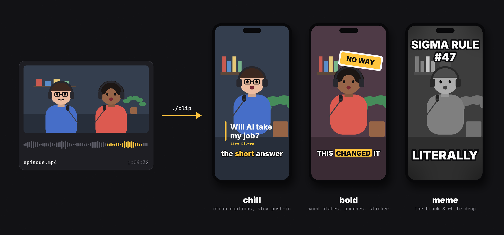
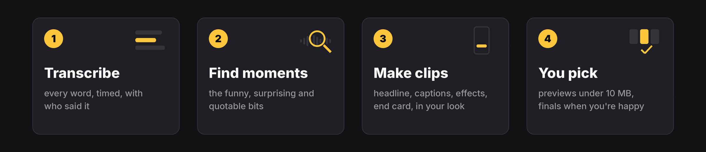

# podcast-clipper

Turn a podcast episode into short vertical clips for TikTok, Reels and Shorts. A coding agent does the editing: it
finds the moments worth sharing and makes clips with a headline, captions, effects and an end card, in your show's
look.



## Get started

You need Python 3.14+, ffmpeg, a coding agent (Claude Code, Codex, Cursor, …) and one API key: an
[OpenAI](https://platform.openai.com/api-keys) key does everything; an [ElevenLabs](https://elevenlabs.io) key
transcribes best (keeps speakers apart most reliably), and the two together are the best setup.

1. `git clone https://github.com/frenkd/podcast-clipper`, open the folder with your agent and ask:
   **"Do the first-time setup."** It installs what's missing (asking first) and runs a self-test.
2. Open `.env` and paste in your key(s). (Never paste keys into the chat.)
3. Ask: **"Make clips from ~/Videos/episode.mp4"**. Add anything that helps (show notes, the guest's name, a moment
   you liked) or just say "go with the defaults".

It shows you previews (`./clip gallery` puts them side by side on one page), you say what to change, and the
finals land in `projects/<episode>/final/`.

## Your first clip in a minute

Know the moment already? One command makes one clip:

```bash
./clip quick my-episode 12:30-13:05 --style news
```

Eleven starting points, from calm to unhinged:

- **Everyday:** `chill` (clean captions, a slow push-in) and `bold` (caps captions, the spoken word on a plate, a
  sticker).
- **Meme formats:** `meme` (one huge word at a time, then the black-and-white "sigma" drop), `dramatic` (a smash zoom
  into the face), `credits` (freeze, "directed by"), `documentary` (letterbox and a narrator card), `news` (a
  BREAKING banner and a joke ticker) and `rewind` (a VHS rewind, then the punchline again).
- **Explainers:** `list`, `chart` and `versus`, boards that build up in sync with what's said.

It writes a short script in `projects/my-episode/scripts/` and renders a preview; with an OpenAI key it also writes
the headline and the board for you. The script is yours: change a word, a colour, the timing, and render again.

These are a starter kit, not the menu. Each clip is plain Python on a small engine that handles the hard parts
(following the speaker, keeping text off faces and out from under the apps' buttons, timing everything to the
words), so an original format is a script away. Ask the agent for one: "make this one a cooking show", "turn the
argument into a boxing match".

## Make it yours

Copy `theme.example.json` to `theme.json`:

```json
{ "name": "My Podcast", "accent": "#FFC53D", "captions": "bold", "logo": "assets/logo.png" }
```

Every clip follows it: colours, fonts, caption style, logo, end card. All the options are in
[`clips/clipkit/theme.py`](clips/clipkit/theme.py), or ask the agent: "make it look like our show, here's our logo".

## What it takes care of



- **Picking moments:** it reads the whole transcript and suggests the funny, surprising and quotable bits.
- **The right person on screen:** it learns the camera angles and who sits where, and follows whoever talks.
- **Nothing looks broken:** every frame is checked so text never covers a face or sits under the apps' buttons,
  and the picture never jumps or freezes mid-sentence.
- **Shareable previews:** always under 10 MB, ready for Discord or a chat. Finals at full quality, using your
  graphics chip's encoder when there is one.
- **Extras:** subtitles (.srt), chapters, a description draft, covers. Optionally it uploads to YouTube Shorts
  ([publish/](publish/README.md)).
- **No copyright trouble:** all music and sound effects are generated in code.

Transcription uses ElevenLabs, [Soniox](https://soniox.com) or OpenAI, whichever key is in `.env`; OpenAI also
reads your notes, cleans up the transcript and writes the headlines. Runs on macOS, Linux and Windows.

## How it's built

Plain Python (numpy, OpenCV, Pillow) and ffmpeg, no web app and no service of its own: it runs on your computer and
talks only to the APIs you give it keys for. The agent reads [AGENTS.md](AGENTS.md) first and follows
[PLAYBOOK.md](PLAYBOOK.md) to make clips; `./clip` is the one command (run it without arguments for help), and each
clip is a small script on the engine in [`clips/clipkit/`](clips/clipkit/).

MIT licensed ([LICENSE](LICENSE)). Fonts: Inter and JetBrains Mono (SIL Open Font License).
